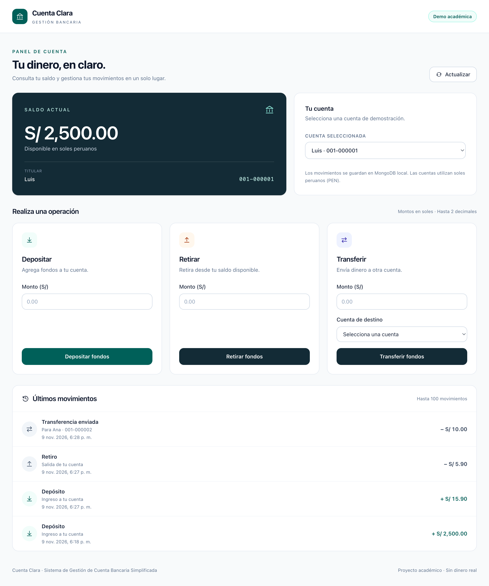
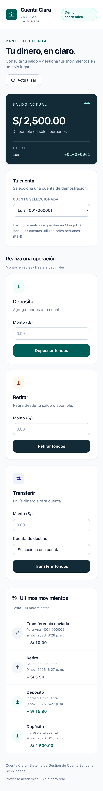

# Sistema de Gestión de Cuenta Bancaria Simplificada

**Cuenta Clara** es una aplicación académica Full-Stack para consultar saldos, depositar, retirar, transferir entre cuentas y consultar movimientos. React actualiza saldo e historial después de cada operación, sin recargar la página.

Repositorio: [luivmz/cuenta-bancaria-fullstack](https://github.com/luivmz/cuenta-bancaria-fullstack).

## Stack y requisitos

- Node.js **20.19 o superior compatible** (verificado con 20.20.2); npm 10 (verificado con 10.8.2).
- MongoDB Community **local**, verificado con 8.0.34, y mongosh 2.14.0.
- Backend: JavaScript ES6+, Express 5.2.1, Mongoose 8.24.8, CORS y Helmet.
- Frontend: React 19.3.1, Vite 8.3.6, Tailwind CSS 4.3.5 mediante `@tailwindcss/vite`, según la [integración oficial para Vite](https://tailwindcss.com/docs/installation/using-vite).
- Tests: Node Test Runner + Supertest; Vitest 4.1.12 + React Testing Library + jsdom.
- Git para clonar. GitHub CLI es opcional para publicar, no para ejecutar.

No requiere autenticación, servicios de nube ni contenedores. Los datos son de demostración; no se conecta a una entidad bancaria.

## Inicio en otra Mac

Si aún no tienes MongoDB, instala la edición local desde [MongoDB para macOS](https://www.mongodb.com/docs/v8.0/tutorial/install-mongodb-on-os-x/). Con Homebrew:

```sh
brew tap mongodb/brew
brew install mongodb-community@8.0
brew services start mongodb-community@8.0
```

Si ya está instalado, solo ejecuta `brew services start mongodb-community@8.0`. No reinstales ni borres sus datos.

Comprueba MongoDB:

```sh
mongod --version
mongosh --version
mongosh 'mongodb://127.0.0.1:27017/admin' --quiet --eval 'db.runCommand({ping:1})'
```

Clona y prepara el backend:

```sh
git clone https://github.com/luivmz/cuenta-bancaria-fullstack.git
cd cuenta-bancaria-fullstack
cd server
cp ../.env.example .env
npm ci
npm run seed
npm test
npm run dev
```

**`npm run seed` reinicia únicamente las colecciones `accounts` y `transactions` de la base dedicada `cuenta_bancaria`.** Ejecútalo con la API detenida y sin operaciones en curso. No lo ejecutes para conservar movimientos de una demostración anterior. Se rechaza cualquier nombre de base distinto. La conexión se cierra al terminar.

En una segunda terminal, desde la raíz del proyecto:

```sh
cd client
npm ci
npm test
npm run build
npm run dev
```

En una tercera terminal, con el backend encendido:

```sh
cd server
npm run smoke
```

- Frontend: **http://localhost:5173**
- Backend: **http://localhost:3000**
- Health: **http://localhost:3000/api/health**

`smoke` necesita la API y MongoDB activos. Crea dos cuentas temporales `999-xxxxxx`, comprueba las seis funciones técnicas y elimina exclusivamente esos datos al terminar. No modifica los saldos del seed.

`npm start` ejecuta el backend sin observación de archivos; `npm run dev` utiliza `node --watch`. Detén cada proceso con Ctrl+C. Para parar el servicio MongoDB de Homebrew: `brew services stop mongodb-community@8.0`.

## Windows y Linux

Instala Node compatible, Git, MongoDB Community local y mongosh desde sus fuentes oficiales: [Windows](https://www.mongodb.com/docs/v8.0/tutorial/install-mongodb-on-windows/) / [Linux](https://www.mongodb.com/docs/v8.0/administration/install-on-linux/). Inicia el servicio MongoDB correspondiente; en Windows, si fue instalado como servicio `MongoDB`, PowerShell administrador: `Start-Service MongoDB`. En Linux con systemd: `sudo systemctl start mongod`.

El código y los scripts npm son JavaScript portables. Usa los mismos comandos de instalación, seed, pruebas y ejecución. Para copiar el entorno en PowerShell, dentro de `server`, sustituye `cp` por:

```powershell
Copy-Item ../.env.example .env
```

La ejecución completa se verificó en macOS ARM64. Windows/Linux tienen instrucciones compatibles, pero no fueron ejecutados en esta entrega.

## Configuración

`server/.env` es local y está ignorado por Git. Copia el archivo raíz `.env.example`:

```dotenv
PORT=3000
MONGODB_URI=mongodb://127.0.0.1:27017/cuenta_bancaria
CLIENT_ORIGIN=http://localhost:5173
```

La ruta de `.env` se resuelve desde el módulo, sin depender del directorio de trabajo. El servidor escucha en `127.0.0.1`. CORS permite el origen configurado; no usa `*`.

Vite reenvía `/api` a `http://127.0.0.1:3000`, por lo que el frontend no necesita `.env`. Si cambias el puerto del backend, cambia también `server.proxy` en `client/vite.config.js`. Opcionalmente puedes crear `client/.env.local` con `VITE_API_URL=http://localhost:3000/api`; toda variable `VITE_*` es pública y nunca debe contener secretos.

`npm run build` genera `client/dist`. `npm run preview` sirve ese build para inspección; para usar la API con preview configura `VITE_API_URL` antes del build y `CLIENT_ORIGIN` con el origen de preview (normalmente `http://localhost:4173`). El flujo habitual de la entrega es `npm run dev` en ambos proyectos.

## Cuentas generadas por el seed

| Número / ID público | Titular | Saldo inicial |
| --- | --- | ---: |
| `001-000001` | Luis | S/ 2,500.00 |
| `001-000002` | Ana | S/ 1,800.00 |
| `001-000003` | Carlos | S/ 900.00 |

Cada saldo inicial tiene un depósito de apertura en el historial. La interfaz permite elegir estas tres cuentas; no hay alta, eliminación ni administración de cuentas. Los saldos cambian con las operaciones; las capturas incluyen movimientos efectuados durante QA.

## Arquitectura y estructura

```text
cuenta-bancaria-fullstack/
├── server/
│   ├── src/
│   │   ├── config/           # Entorno, conexión y detección de topología
│   │   ├── controllers/      # Entrada HTTP y respuestas
│   │   ├── models/           # Account y Transaction (Mongoose)
│   │   ├── routes/           # Endpoints requeridos
│   │   ├── services/         # Reglas, concurrencia y consistencia
│   │   ├── middleware/      # Errores JSON
│   │   ├── utils/           # Dinero, serialización y cola standalone
│   │   ├── app.js           # Express exportable para pruebas
│   │   └── server.js        # Arranque y cierre de conexiones
│   ├── scripts/             # seed.js y smoke.js
│   └── tests/               # Integración real + unidades
├── client/
│   ├── public/              # Favicon SVG
│   ├── src/
│   │   ├── components/      # Formularios reutilizables, saldo e historial
│   │   ├── hooks/           # useBanking: carga y sincronización
│   │   └── services/        # Peticiones fetch centralizadas
│   └── tests/               # Componentes, API y dinero
├── docs/QA.md
├── docs/capturas/
├── .env.example
├── spec.md
└── PLAN.md
```

Flujo: **Route → Controller → Service → Model → MongoDB**. `app.js` no abre puertos al importarse. El controlador entrega HTTP; el servicio valida y coordina las escrituras.

En React, `useBanking` conserva mediante `useState` la cuenta seleccionada, cuenta, saldo, historial, carga, operación activa, errores y éxitos. `useEffect` carga cuenta e historial al inicio y al cambiar selección, y cancela consultas obsoletas. `OperationForm` conserva montos y destino como campos controlados; recibe el callback por props. `SaldoCard` recibe saldo y `HistorialTransacciones` recibe movimientos. No usa Context/Redux.

Tras una operación se vuelven a consultar cuenta e historial con `Promise.all`. Se bloquean formularios y selección durante el envío; un bloqueo síncrono con `useRef` evita doble submit. Si la escritura tuvo éxito pero la lectura posterior falla, se informa el resultado y se deshabilitan operaciones hasta pulsar **Actualizar**. No se utiliza `window.location.reload()`.

## Modelo MongoDB y dinero

- **Account**: `accountNumber` único/inmutable, `holderName` limpio, `balance` entero seguro >= 0 en **centavos**, `createdAt`, `updatedAt`.
- **Transaction**: `type` (`DEPOSIT`, `WITHDRAWAL`, `TRANSFER`), `amount` entero positivo en **centavos**, referencias `sourceAccount` / `destinationAccount`, timestamps e índices por participante/fecha.
- Depósito: solo destino; retiro: solo origen; transferencia: ambos, distintos. Una transferencia crea **un movimiento** consultable desde ambas cuentas.

La API recibe `monto` como **número JSON en soles**: `15.90` se transforma en `1590` mediante parseo decimal y BigInt, sin multiplicar floats para almacenar dinero. Se rechazan más de dos decimales, texto, booleanos, null, valores no finitos y cifras fuera del entero seguro. Los saldos no pueden superar `Number.MAX_SAFE_INTEGER` centavos.

La respuesta incluye `balance`/`amount` en soles para comodidad y **`balanceCents`/`amountCents` como representación exacta autoritativa**. Para cantidades extremas, los números JSON en soles pueden perder precisión de presentación; usa los campos en centavos. La interfaz formatea por separado parte entera y centavos.

## API REST

`:id` es el **número estable de cuenta**, por ejemplo `001-000001`; no es el ObjectId interno.

| Método | Ruta | Cuerpo | Resultado |
| --- | --- | --- | --- |
| GET | `/api/health` | — | Estado MongoDB y modo de consistencia |
| GET | `/api/cuenta/:id` | — | Cuenta y saldo |
| POST | `/api/cuenta/deposito` | `{ "cuentaId": "001-000001", "monto": 500 }` | Cuenta y depósito |
| POST | `/api/cuenta/retiro` | `{ "cuentaId": "001-000001", "monto": 300 }` | Cuenta y retiro |
| POST | `/api/cuenta/transferencia` | `{ "cuentaOrigenId": "001-000001", "cuentaDestinoId": "001-000002", "monto": 400 }` | Ambas cuentas y transferencia |
| GET | `/api/cuenta/:id/historial` | — | Hasta 100 movimientos, más recientes primero |

Éxito: `{ "data": ... }`. Error: `{ "error": { "code": "...", "message": "..." } }`. No se devuelven stacks ni campos internos del modelo.

HTTP: **200** correcto; **400** entrada inválida, cuenta propia, saldo insuficiente o límite excedido; **404** cuenta/ruta inexistente; **413** cuerpo >10 KB; **500** fallo inesperado; **503** health no disponible u operaciones bloqueadas para revisión de consistencia.

Ejemplo real:

```sh
curl http://localhost:3000/api/cuenta/001-000001
curl -X POST http://localhost:3000/api/cuenta/deposito \
  -H 'Content-Type: application/json' \
  -d '{"cuentaId":"001-000001","monto":15.9}'
curl http://localhost:3000/api/cuenta/001-000001/historial
```

## Transferencias y prevención de saldo negativo

El arranque consulta `hello`. Si hay `setName` (replica set) o mongos, usa `mongoose.startSession()` y `session.withTransaction()`: el débito, crédito y movimiento se confirman o revierten juntos.

En **standalone**, las mutaciones y consultas de cuenta/historial pasan por una cola dentro de un único proceso. Se valida la existencia de ambas cuentas antes de debitar. Los cambios confirmados se compensan en orden inverso si falla un paso posterior, incluido registrar el historial. Si una compensación falla o una escritura tiene resultado incierto por un error de red, se bloquean nuevas operaciones con 503 y se registra `CONSISTENCY_REVIEW_REQUIRED`. Revisa los documentos afectados antes de reiniciar; no reintentes operaciones de resultado desconocido sin consultar saldos e historial.

**Limitación concreta:** standalone no garantiza atomicidad multi-documento frente a una caída de proceso/red. No ejecutes varias instancias del backend, seed simultáneo ni escritores externos en ese modo. Usa replica set para atomicidad real. El bloqueo por revisión es en memoria y se pierde al reiniciar.

Todo débito usa `$inc` con filtro `balance >= monto`; todo crédito verifica el máximo entero seguro antes de incrementar. Nunca se calcula un retiro mediante leer/restar/guardar sin condición. Hay pruebas concurrentes de retiros y transferencias, rollback y fallos de historial en ambos modos.

### Replica set local opcional, separado del servicio existente

No necesitas convertir ni borrar tu MongoDB de Homebrew. En otra terminal, desde un directorio de usuario y con el puerto 27018 libre:

```sh
mkdir -p "$HOME/cuenta-bancaria-rs"
mongod --dbpath "$HOME/cuenta-bancaria-rs" --replSet rs0 --port 27018 --bind_ip 127.0.0.1
```

En otra terminal, solo la primera vez:

```sh
mongosh 'mongodb://127.0.0.1:27018/admin?directConnection=true' --eval 'rs.initiate({_id:"rs0",members:[{_id:0,host:"127.0.0.1:27018"}]})'
```

Espera a que `db.hello().isWritablePrimary` sea `true`. Con la API detenida cambia en `server/.env`:

```dotenv
MONGODB_URI=mongodb://127.0.0.1:27018/cuenta_bancaria?replicaSet=rs0
```

Después ejecuta seed e inicia nuevamente la API. `GET /api/health` debe indicar `consistency: "transaction"`. Los datos del servicio 27017 y de esta instancia son independientes. Detén este mongod con Ctrl+C en su terminal. Referencia: [replica set de desarrollo](https://www.mongodb.com/docs/manual/tutorial/deploy-replica-set-for-testing/).

## Pruebas y calidad

Backend, con MongoDB activo (no necesita la API para `npm test`):

```sh
cd server
npm test
npm run test:unit
npm run test:integration
npm audit
```

Las pruebas de integración crean una base con nombre aleatorio `cuenta_bancaria_test_<uuid>` y la eliminan solo si coincide exactamente con el nombre generado. No usan ni limpian `cuenta_bancaria`. Por defecto conectan a 27017, independientemente de `MONGODB_URI` de la aplicación.

Para comprobar la rama transaccional con el replica set opcional:

```sh
TEST_MONGODB_URI='mongodb://127.0.0.1:27018/?replicaSet=rs0' npm run test:integration
```

En PowerShell: `$env:TEST_MONGODB_URI='mongodb://127.0.0.1:27018/?replicaSet=rs0'` y luego `npm run test:integration`. La URI de pruebas es local y de un solo host.

Frontend:

```sh
cd client
npm test
npm run build
npm audit
```

Resultado de esta entrega: **75/75 backend standalone**, **50/52 integración replica set con 2 omitidas por ser exclusivas de standalone**, **21/21 frontend**, smoke **6/6**, build correcto y **0 vulnerabilidades** en ambos proyectos. Consulta la evidencia, alcance de QA visual y avisos en [docs/QA.md](docs/QA.md).

## Capturas reales

Capturadas durante QA en Chrome con viewport CSS 1280 px y 360 px. Incluyen movimientos de prueba reales, sin dinero real.

[Escritorio completo](docs/capturas/escritorio-1280.png) · [Móvil completo, 360 px](docs/capturas/mobile-360.png)



<details><summary>Vista móvil</summary>

</details>

## Alcance y limitaciones

- Aplicación local académica sin autenticación; cualquier cliente con acceso a la API local puede operar las cuentas. No publicar la API en Internet como banca real.
- La interfaz selecciona únicamente las tres cuentas del seed; la API acepta cualquier cuenta existente con el formato definido.
- Historial limitado a los últimos 100 movimientos, sin paginación ni exportación.
- Sin idempotencia entre reintentos manuales: una solicitud repetida es una operación nueva. Tras un error de red, consulta saldo/historial antes de repetir.
- Standalone usa compensación con las limitaciones detalladas arriba; replica set ofrece transacciones reales.
- Las pruebas frontend utilizan una API simulada; el recorrido manual del navegador y el smoke verifican integración real.
- La accesibilidad incluye labels, mensajes anunciados, foco visible y teclado. No se hizo una auditoría formal con lector de pantalla.

## Especificación y Git

[spec.md](spec.md) contiene contratos, reglas, casos extremos y aceptación; [PLAN.md](PLAN.md) relaciona fases con evidencia. Los commits son semánticos. `.env`, `node_modules`, logs, coverage y dist están ignorados; ambos lockfiles sí se versionan. No se requieren credenciales de GitHub para ejecutar localmente.
